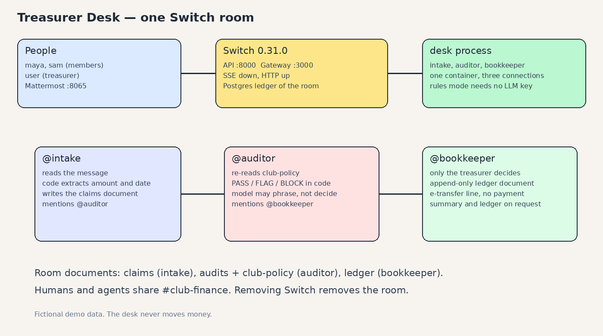

# Treasurer Desk

A club treasurer clears reimbursements in one Switch room. `@intake` files the claim, `@auditor` applies the written policy, and `@bookkeeper` records only the treasurer's decision.


Demo recording, rules mode, fictional data: [`docs/demo.mp4`](docs/demo.mp4) (1 minute 46 seconds). The replies in the video were produced by the running agents. No LLM key was used.

## The problem

A student club pays members back from a shared budget. The request arrives as a chat message, a photo, and a hope that the treasurer copies it into a spreadsheet. Caps get applied differently each time, duplicates slip through, and nobody can see who decided.

## How Switch is used

Headless self-host. No Switch Console. Switch is the room: the identities, the @mentions, the shared documents, and the Mattermost bridge. Remove Switch and there is no room to stand in.

The mapping of each feature to a line of code is in [`docs/how-switch-is-used.md`](docs/how-switch-is-used.md).

## Architecture



One Python process opens three Switch connections. Intake, the auditor, and the bookkeeper hand work to each other by @mention (`send_targeted_message`). The claims list, the policy, the audits, and the ledger are Switch room documents. On boot the agents read those documents again, so a restarted container still has the ledger.

```
member (Mattermost) -- @intake --> claim document
                              |
                              @auditor --> policy engine --> audits document
                                                |
                                                @bookkeeper --> ledger document
treasurer -- approve | reject | adjust --------^
```

## Quickstart

Prerequisites: Docker with Compose v2, and Python 3.12 if you want the unit tests outside the container.

```bash
python3 -m venv .venv
. .venv/bin/activate
pip install -e ".[dev]"
make up          # Switch 0.31.0, Mattermost, Gateway. Writes .env with random secrets.
make seed        # fictional members maya and sam
make desk        # the three agents, LLM_MODE=rules
make e2e         # the flow against the running server
```

`make demo` resets volumes and runs that sequence. Ports, bound to localhost: Switch API `8000`, Gateway `3000`, Mattermost `8065`.

Log in to Mattermost at `http://127.0.0.1:8065` as `user` (the treasurer), `maya`, or `sam`. Passwords are in `.env`, which is not committed. The channel is `club-finance`.

Rules mode is the default. For a live model, set `LLM_MODE=live`, `LLM_BASE_URL`, `LLM_API_KEY`, and `LLM_MODEL` in `.env` and restart the desk. Amounts and dates still come from `desk/rules.py`. The model may phrase the explanation and may fill an empty category. It cannot change `PASS`, `FLAG`, or `BLOCK`.

## The workflow

Captured from Mattermost by `tests/e2e/test_flow.py` on 4 Nov 2026, rules mode. The full thread is [`demo/transcript.md`](demo/transcript.md). Measured claim-to-verdict time in that run: **1.022 seconds** (`demo/metrics.json`).

Maya files a $42.30 pizza claim. Intake posts claim `C-001` and mentions the auditor. The auditor posts `C-001 PASS` and mentions the bookkeeper. The bookkeeper waits. The treasurer (`user`) writes `@bookkeeper approve C-001`. The bookkeeper appends the ledger and prints an e-transfer line for the treasurer to pay by hand.

A $90 claim is `FLAG` (the cap is $75). Approving it without `override="reason"` is refused. `@bookkeeper adjust C-002 amount=38.00` re-runs the rules on $38.00, gets `PASS`, and books $38.00. Beer is `BLOCK`. A second copy of the $42.30 claim is `BLOCK` as a duplicate. "I think I paid something for snacks" gets `I could not read that, please use claim <amount> <what> <date>`. Sam's approval is refused. After `docker restart` of the desk container, `@bookkeeper ledger` still lists the approved rows.

## Policy

The packaged copy is [`policy/club-policy.yaml`](policy/club-policy.yaml), explained in [`policy/club-policy.md`](policy/club-policy.md). On first boot the auditor copies it into the room document `club-policy` and re-reads that document on every claim.

The treasurer can replace it from the room:

```
@auditor apply-policy
```yaml
max_claim_amount: "80.00"
preapproval_threshold: "200.00"
receipt_max_age_days: 14
banned_categories: [alcohol]
default_event_budget: "150.00"
event_budgets:
  thursday-meetup: "200.00"
```
```

`DESK_SYNC_POLICY=always` overwrites that document from the file on boot. The default, `seed`, leaves an edited document in place.

## Tests

```bash
make unit    # 24 tests, no server
make lint
make e2e     # real Switch 0.31.0 and Mattermost, rules mode
```

Unit tests cover the parser (25 messy claim strings), the rules engine (cap, alcohol, receipt age, duplicate, event budget, override), ledger append idempotency, and the treasurer check. The e2e test posts the five scenarios above, checks sam is refused, and restarts the desk container.

GitHub Actions: `.github/workflows/ci.yml` runs lint and unit tests. `.github/workflows/e2e.yml` runs `make demo` on an Ubuntu runner. Those workflows had not been executed by GitHub at the time of this commit. The numbers above are from this machine.

## Limits

The desk stops at the e-transfer line. Nobody here sends money.

A verdict is the return value of `policy.evaluate`. The wording step runs after that and is given the status. In rules mode the paragraph is a template.

maya, sam, `user`, and every claim in the demo are fictional.

A receipt is a text reference. There is no image OCR.

The bridge exercised here is the bundled Mattermost. Slack, Teams, and Discord were not configured.

One room, one club policy.

Switch lets the creating agent update a room document through the API. The treasurer changes policy by posting `@auditor apply-policy` with YAML. The auditor writes the document.

`@auditor why` reports the verdict that was recorded and the ledger row. If a later claim makes the same facts fail today, the reply says so and leaves the ledger row as it was.

A fresh desk process listens from the head of the stream. A message sent while the process is down is not replayed. The documents are.

## Built during the hackathon

The entry repo was created empty. This work was written after the event start (3 Nov 2026, 1:31 PM ET). It was built with AI coding assistance (Cursor cloud agent) and reviewed as code in this repository. Switch is used unmodified as a server. Its licence is Apache-2.0 plus a modified Commons Clause. This repository is MIT and does not vendor Switch source. It should not be folded into a paid product that sells Switch or a derivative without a legal reading of that clause.

## Credits

Switch is the room, from [sandbox-quantum/switch](https://github.com/sandbox-quantum/switch). Mattermost is the bundled chat. The agents, the policy engine, and the ledger format are this repo.

Entrant: Nigel (`nigelose10`). Registration and the hackathon submit button are his to click. See [`SUBMISSION.md`](SUBMISSION.md) for paste-ready text. Nothing in this repo was submitted to the form.
